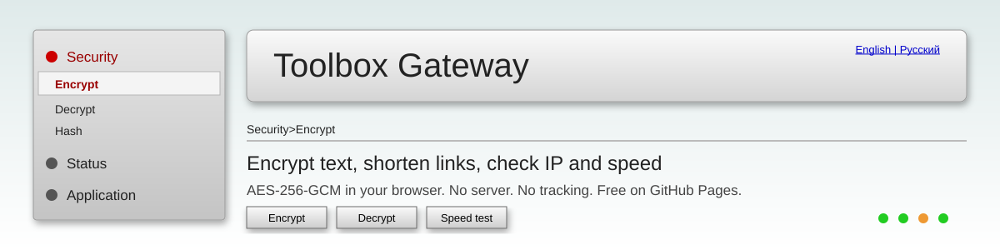

<p align="center">
  
</p>

<h1 align="center">Toolbox Gateway</h1>

<p align="center">
  <b>English</b> | <a href="README.ru.md">Русский</a>
</p>

<p align="center">
  Free online toolbox in the style of an old router admin panel.<br>
  Encrypt text, shorten links, find your IP, test your internet speed.
</p>

<p align="center">
  <a href="https://YOUR_USERNAME.github.io/YOUR_REPO/"></a>
  
  
</p>

<p align="center">
  
  
  
  
  
  
  <a href="LICENSE"></a>
  
</p>

<p align="center">
  <a href="#-features">Features</a> ·
  <a href="#-quick-start">Quick start</a> ·
  <a href="#-encryption-methods">Encryption</a> ·
  <a href="#-security">Security</a> ·
  <a href="#-privacy">Privacy</a> ·
  <a href="#-roadmap">Roadmap</a> ·
  <a href="#-faq">FAQ</a>
</p>

---

## 📖 Table of contents

- [Features](#-features)
- [Live demo](#-live-demo)
- [Quick start](#-quick-start)
- [Encryption methods](#-encryption-methods)
- [Project structure](#-project-structure)
- [Security](#-security)
- [Privacy](#-privacy)
- [Limitations](#-limitations)
- [Roadmap](#-roadmap)
- [Contributing](#-contributing)
- [FAQ](#-faq)
- [License](#-license)

## ✨ Features

| Tool | What it does | Where it runs |
| --- | --- | --- |
| 🌐 My IP | Shows your IP, country, city, provider and time zone | Browser plus ipwho.is |
| 🚀 Speed test | Measures ping, jitter, download and upload | Browser plus Cloudflare |
| 🔐 Encrypt | 19 methods, from AES-256-GCM to Caesar and Morse | Browser only |
| 🔓 Decrypt | The same 19 methods in reverse | Browser only |
| #️⃣ Hash | SHA-1, SHA-256, SHA-384, SHA-512 | Browser only |
| 🔑 Password | Random passwords from 8 to 64 characters | Browser only |
| 🔗 Short link | Shortens any http or https link | Third-party services |
| 🌍 Languages | English and Russian, saved in the browser | Browser only |

Design: gray menu, beveled buttons, sunken fields and soft shadows, like the admin page of an old GPON router.

## 🚀 Live demo

<p align="center">
  <a href="https://YOUR_USERNAME.github.io/YOUR_REPO/"><b>https://YOUR_USERNAME.github.io/YOUR_REPO/</b></a>
</p>

> Add a screenshot to `assets/screenshot.png` and show it here with ``.

## ⚡ Quick start

### Publish on GitHub Pages

1. Create a new repository on GitHub.
2. Upload all files from this project to the root of the repository.
3. Open <b>Settings</b>, then <b>Pages</b>.
4. In <b>Source</b> choose the branch `main` and the folder `/ (root)`. Press <b>Save</b>.
5. Wait a minute. The site opens at `https://YOUR_USERNAME.github.io/YOUR_REPO/`.
6. Turn on <b>Enforce HTTPS</b> in the same menu.

### Run locally

```bash
git clone https://github.com/YOUR_USERNAME/YOUR_REPO.git
cd YOUR_REPO
python3 -m http.server 8000
```

Open http://localhost:8000. You do not need Node.js, npm or any build step.

## 🔐 Encryption methods

| Group | Methods | Key |
| --- | --- | --- |
| Modern | AES-GCM 256, 192, 128 · AES-CBC 256, 128 · AES-CTR 256, 128 | Password |
| Stream and XOR | RC4 · XOR | Password |
| Classic | Caesar · Vigenere · Atbash · ROT13 | Number, word or none |
| Encodings | Base64 · Hex · Binary · URL · Morse · Reverse | None |

How the modern methods work:

- The password goes through PBKDF2 (SHA-256, 310 000 iterations).
- Every encryption uses a new random salt (16 bytes) and a new IV.
- The result is one Base64 string: salt, IV and ciphertext.

> Use AES-GCM for anything important. It checks that the data was not changed. Classic ciphers and encodings are for fun and learning, they do not protect your data.

## 📁 Project structure

```text
.
├── index.html        # Page markup and Content Security Policy
├── style.css         # Router style: bevels, gradients, shadows
├── app.js            # All logic: ciphers, hash, speed test, shortener, i18n
├── assets/
│   └── banner.svg    # Banner for this README
├── .nojekyll         # Tells GitHub Pages to serve files as they are
├── LICENSE
├── README.md         # English
└── README.ru.md      # Russian
```

## 🛡 Security

- Encryption and hashing use the browser Web Crypto API. Your text is never sent anywhere.
- A strict Content Security Policy in `index.html` limits scripts, styles and requests to a short list of hosts.
- All output goes through `textContent`, so typed text cannot run as code.
- Links for the shortener are checked: only `http` and `https`, no logins in the address, length up to 2048.
- Passwords are generated with `crypto.getRandomValues`, without modulo bias.
- No cookies, no accounts, no analytics, no database.
- GitHub Pages serves the site over HTTPS.

GitHub Pages cannot set HTTP headers such as `X-Frame-Options`. A meta CSP covers most cases, but not framing protection.

## 🔒 Privacy

The site has no server of its own. These services get a request only when you use the matching tool:

| Tool | Service | What it receives |
| --- | --- | --- |
| My IP | ipwho.is | Your IP address (it sees it in the request) |
| Speed test | speed.cloudflare.com, cdn.jsdelivr.net | Test traffic and your IP |
| Short link | cleanuri.com, is.gd, v.gd, 1pt.co | The link you shorten |

Encrypt, Decrypt, Hash and Password never make network requests.

## ⚠ Limitations

- Short links are stored by third-party services. If a service closes, its links stop working.
- Speed test results depend on your browser, VPN and ad blocker.
- If no shortener answers, the site makes a long link that holds the address inside. It opens on a page that shows the target and asks you to confirm.
- Ad blockers can block the IP, speed and shortener requests.

## 🗺 Roadmap

- [x] Encrypt and decrypt with a choice of methods
- [x] Speed test
- [x] English and Russian
- [ ] Password strength meter
- [ ] Password leak check (Have I Been Pwned, k-anonymity)
- [ ] QR code generator
- [ ] Subnet calculator
- [ ] DNS lookup over HTTPS
- [ ] JSON formatter
- [ ] Unix time converter
- [ ] Admin page with Supabase (login, statistics)

## 🤝 Contributing

Pull requests and ideas are welcome.

1. Fork the repository.
2. Create a branch: `git checkout -b feature/my-tool`.
3. Keep the project simple: plain HTML, CSS and JavaScript, no build step.
4. Add every new text to both languages in the `L` object in `app.js`.
5. Do not use `innerHTML` with user data.
6. Open a pull request and describe what you changed.

## ❓ FAQ

<details>
<summary>Can someone read my encrypted text?</summary>

With AES-GCM and a strong password, no. Without the password the text cannot be restored. If you lose the password, nobody can recover the data.
</details>

<details>
<summary>Why is the short link not short?</summary>

All shortener services did not answer, so the site made a link that stores the address inside. Turn off the ad blocker and VPN and try again.
</details>

<details>
<summary>Why does the speed test show a low result?</summary>

The test runs in the browser for a few seconds. A VPN, a weak server in your region or the fallback files from jsDelivr can lower the result. Run it two or three times.
</details>

<details>
<summary>Can I add a login and an admin page?</summary>

Not safely on GitHub Pages alone, because every visitor can read the code. Use a service such as Supabase with Row Level Security and two-factor login.
</details>

## 📄 License

MIT. See the [LICENSE](LICENSE) file.

<p align="center">
  Made with care for people who like old router panels.
</p>
