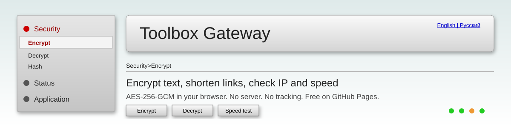

<p align="center">
  
</p>

<h1 align="center">Toolbox Gateway</h1>

<p align="center">
  <a href="README.md">English</a> | <b>Русский</b>
</p>

<p align="center">
  Бесплатный набор онлайн инструментов в стиле админки старого роутера.<br>
  Шифрует текст, сокращает ссылки, показывает IP и проверяет скорость интернета.
</p>

<p align="center">
  <a href="https://YOUR_USERNAME.github.io/YOUR_REPO/"></a>
  
  
</p>

<p align="center">
  
  
  
  
  
  
  <a href="LICENSE"></a>
  
</p>

<p align="center">
  <a href="#-возможности">Возможности</a> ·
  <a href="#-быстрый-старт">Быстрый старт</a> ·
  <a href="#-методы-шифрования">Шифрование</a> ·
  <a href="#-безопасность">Безопасность</a> ·
  <a href="#-приватность">Приватность</a> ·
  <a href="#-планы">Планы</a> ·
  <a href="#-вопросы-и-ответы">FAQ</a>
</p>

---

## 📖 Содержание

- [Возможности](#-возможности)
- [Демо](#-демо)
- [Быстрый старт](#-быстрый-старт)
- [Методы шифрования](#-методы-шифрования)
- [Структура проекта](#-структура-проекта)
- [Безопасность](#-безопасность)
- [Приватность](#-приватность)
- [Ограничения](#-ограничения)
- [Планы](#-планы)
- [Участие в проекте](#-участие-в-проекте)
- [Вопросы и ответы](#-вопросы-и-ответы)
- [Лицензия](#-лицензия)

## ✨ Возможности

| Инструмент | Что делает | Где работает |
| --- | --- | --- |
| 🌐 Мой IP | Показывает IP, страну, город, провайдера и часовой пояс | Браузер и ipwho.is |
| 🚀 Тест скорости | Измеряет ping, jitter, скачивание и отдачу | Браузер и Cloudflare |
| 🔐 Шифрование | 19 методов, от AES-256-GCM до Цезаря и азбуки Морзе | Только браузер |
| 🔓 Расшифровка | Те же 19 методов в обратную сторону | Только браузер |
| #️⃣ Хеш | SHA-1, SHA-256, SHA-384, SHA-512 | Только браузер |
| 🔑 Пароль | Случайные пароли от 8 до 64 символов | Только браузер |
| 🔗 Короткая ссылка | Сокращает любую ссылку с http или https | Сторонние сервисы |
| 🌍 Языки | Русский и английский, выбор запоминается | Только браузер |

Дизайн: серое меню, объёмные кнопки, вдавленные поля и мягкие тени, как на странице админки старого GPON роутера.

## 🚀 Демо

<p align="center">
  <a href="https://YOUR_USERNAME.github.io/YOUR_REPO/"><b>https://YOUR_USERNAME.github.io/YOUR_REPO/</b></a>
</p>

> Добавь скриншот в `assets/screenshot.png` и покажи его здесь так: ``.

## ⚡ Быстрый старт

### Выложить на GitHub Pages

1. Создай новый репозиторий на GitHub.
2. Загрузи все файлы проекта в корень репозитория.
3. Открой <b>Settings</b>, затем <b>Pages</b>.
4. В поле <b>Source</b> выбери ветку `main` и папку `/ (root)`. Нажми <b>Save</b>.
5. Подожди минуту. Сайт откроется по адресу `https://YOUR_USERNAME.github.io/YOUR_REPO/`.
6. В этом же меню включи <b>Enforce HTTPS</b>.

### Запустить на компьютере

```bash
git clone https://github.com/YOUR_USERNAME/YOUR_REPO.git
cd YOUR_REPO
python3 -m http.server 8000
```

Открой http://localhost:8000. Node.js, npm и сборка не нужны.

## 🔐 Методы шифрования

| Группа | Методы | Ключ |
| --- | --- | --- |
| Современные | AES-GCM 256, 192, 128 · AES-CBC 256, 128 · AES-CTR 256, 128 | Пароль |
| Потоковые и XOR | RC4 · XOR | Пароль |
| Классические | Цезарь · Виженер · Атбаш · ROT13 | Число, слово или без ключа |
| Кодировки | Base64 · Hex · Binary · URL · Морзе · Реверс | Без ключа |

Как работают современные методы:

- Пароль проходит через PBKDF2 (SHA-256, 310 000 итераций).
- Для каждого шифрования создаются новая случайная соль (16 байт) и новый IV.
- Результат это одна строка Base64: соль, IV и зашифрованный текст.

> Для важных данных используй AES-GCM. Он проверяет, что данные не изменили. Классические шифры и кодировки нужны для игры и обучения, они не защищают данные.

## 📁 Структура проекта

```text
.
├── index.html        # Разметка страницы и политика безопасности CSP
├── style.css         # Стиль роутера: объём, градиенты, тени
├── app.js            # Вся логика: шифры, хеш, тест скорости, ссылки, языки
├── assets/
│   └── banner.svg    # Баннер для этого README
├── .nojekyll         # Говорит GitHub Pages отдавать файлы как есть
├── LICENSE
├── README.md         # Английская версия
└── README.ru.md      # Русская версия
```

## 🛡 Безопасность

- Шифрование и хеши работают через Web Crypto API браузера. Твой текст никуда не отправляется.
- Строгая политика CSP в `index.html` ограничивает скрипты, стили и запросы коротким списком адресов.
- Весь вывод идёт через `textContent`, поэтому введённый текст не выполнится как код.
- Ссылки для сокращения проверяются: только `http` и `https`, без логина в адресе, длина до 2048 символов.
- Пароли создаются через `crypto.getRandomValues` без смещения.
- Нет cookie, аккаунтов, аналитики и базы данных.
- GitHub Pages отдаёт сайт по HTTPS.

GitHub Pages не позволяет задавать HTTP заголовки, например `X-Frame-Options`. CSP в meta закрывает большинство случаев, но не защиту от встраивания в iframe.

## 🔒 Приватность

У сайта нет своего сервера. Эти сервисы получают запрос только тогда, когда ты используешь нужный инструмент:

| Инструмент | Сервис | Что получает |
| --- | --- | --- |
| Мой IP | ipwho.is | Твой IP адрес (видит его в запросе) |
| Тест скорости | speed.cloudflare.com, cdn.jsdelivr.net | Тестовый трафик и твой IP |
| Короткая ссылка | cleanuri.com, is.gd, v.gd, 1pt.co | Ссылку, которую ты сокращаешь |

Шифрование, расшифровка, хеш и пароль не делают сетевых запросов.

## ⚠ Ограничения

- Короткие ссылки хранят сторонние сервисы. Если сервис закроется, его ссылки перестанут работать.
- Результат теста скорости зависит от браузера, VPN и блокировщика рекламы.
- Если ни один сокращатель не ответил, сайт делает длинную ссылку с адресом внутри. Она открывается на странице, которая показывает адрес и просит подтвердить переход.
- Блокировщики рекламы могут блокировать запросы IP, скорости и сокращателя.

## 🗺 Планы

- [x] Шифрование и расшифровка с выбором метода
- [x] Тест скорости
- [x] Русский и английский языки
- [ ] Оценка силы пароля
- [ ] Проверка пароля на утечки (Have I Been Pwned, k-anonymity)
- [ ] Генератор QR кодов
- [ ] Калькулятор подсетей
- [ ] DNS запросы через HTTPS
- [ ] JSON форматтер
- [ ] Конвертер Unix времени
- [ ] Админка на Supabase (вход, статистика)

## 🤝 Участие в проекте

Pull request и идеи приветствуются.

1. Сделай форк репозитория.
2. Создай ветку: `git checkout -b feature/my-tool`.
3. Держи проект простым: чистые HTML, CSS и JavaScript, без сборки.
4. Добавляй каждый новый текст на оба языка в объект `L` в `app.js`.
5. Не используй `innerHTML` с данными пользователя.
6. Открой pull request и опиши, что изменил.

## ❓ Вопросы и ответы

<details>
<summary>Сможет ли кто-то прочитать мой зашифрованный текст?</summary>

С AES-GCM и надёжным паролем нет. Без пароля текст не восстановить. Если потеряешь пароль, данные не вернёт никто.
</details>

<details>
<summary>Почему короткая ссылка не короткая?</summary>

Ни один сервис сокращения не ответил, поэтому сайт сделал ссылку с адресом внутри. Отключи блокировщик рекламы и VPN и попробуй снова.
</details>

<details>
<summary>Почему тест скорости показывает мало?</summary>

Тест идёт в браузере несколько секунд. VPN, слабый сервер в твоём регионе или запасные файлы с jsDelivr могут занизить результат. Запусти тест два или три раза.
</details>

<details>
<summary>Можно ли добавить вход и админку?</summary>

Безопасно только на GitHub Pages нельзя, потому что каждый посетитель может прочитать код. Используй сервис вроде Supabase с Row Level Security и двухфакторным входом.
</details>

## 📄 Лицензия

MIT. См. файл [LICENSE](LICENSE).

<p align="center">
  Сделано для тех, кто любит старые панели роутеров.
</p>
